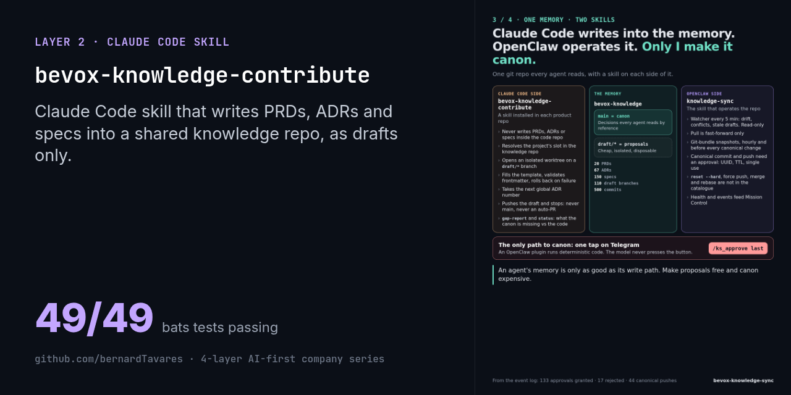
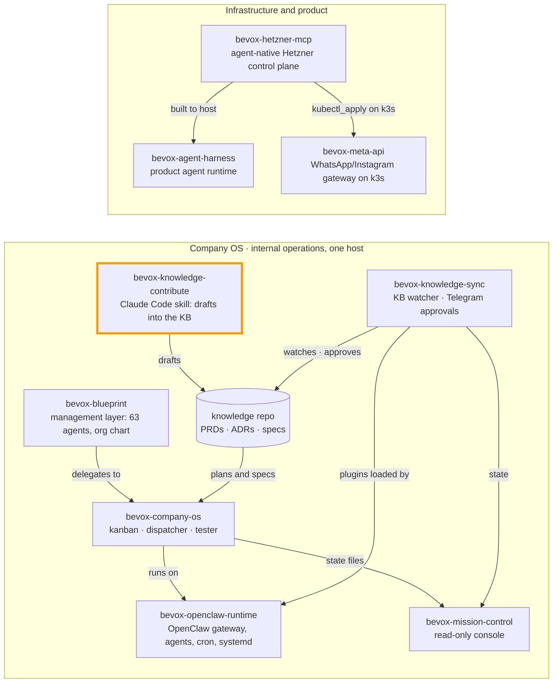

# bevox-knowledge-contribute

[](#) [](./LICENSE.md)  



> Part of the [4-layer AI-first company series](https://github.com/bernardTavares) ([how the repos fit together](#how-the-repos-fit-together)). License: FSL-1.1-MIT (source-available, converts to MIT after 2 years)

A **Claude Code skill** that lets coding agents write PRDs, ADRs, specs, runbooks and release notes into a **shared, git-backed knowledge repo**, as proposals only. It never writes them into the code repo and never touches `main`.

It is the Claude Code half of the Bevox knowledge spine. The other half is [bevox-knowledge-sync](https://github.com/bernardTavares/bevox-knowledge-sync), the OpenClaw skill that watches the knowledge repo, snapshots it and turns canonical changes into a one-tap human approval on Telegram.

> **Status:** used internally at Bevox. It was installed in three repos (the backend, the agent harness and the OpenClaw ops repo) next to a private knowledge repo of PRDs, ADRs and specs. That knowledge repo is not included here. This repo ships the skill, its helpers, the document templates and an example layout, so you can run it against your own knowledge repo.

## Why

Agents that write docs inside each code repo create many copies of the truth. Bevox's design is **one knowledge repo** that every agent reads by reference:
- `main` is the canon;
- `draft/*` branches are proposals that any agent can make and anyone can throw away;
- only a human promotes a draft to canon.

This skill is the safe write path for Claude Code into that repo.

## What the skill does

Installed per project, it knows that project's **slot**: its subfolder inside every canonical folder. It has five subcommands:

| Subcommand | What it does | Writes? |
|---|---|---|
| `bootstrap` | Creates the project's slot under every canonical folder, on a draft branch | draft branch |
| `gap-report` | Compares the canon with the code repo's local docs and implicit decisions; says what to migrate, draft or retire | no |
| `migrate <doc>` | Classifies a local doc, normalizes it into canonical form and proposes it | draft branch |
| `propose <type> <slug>` | New doc from a template: naming convention, next global ADR number, validated frontmatter | draft branch |
| `status` | Diffs local docs vs canon (missing, orphaned, stale) | no |

Guarantees, enforced by the helpers and covered by tests:
- every write happens in an **isolated git worktree** on a `draft/*` branch; it never writes to `main`;
- it **never opens a PR on its own**; it prints the branch and lets a human decide;
- frontmatter is **validated per doc type** before commit, and the file is rolled back on failure;
- ADR numbers are **global and sequential** across all projects;
- it never runs `git push --force`.

## Folder layout

```
00_inbox/  10_prd/  20_architecture/  30_adr/  35_specs/
40_roadmap/  50_releases/  60_customer-feedback/  70_metrics/
99_templates/            ← document templates + this skill
```

Every folder has **the same subfolder per slot** (`_shared`, `backend`, `web`, …), so any agent knows that the backend's ADRs are always in `30_adr/backend/`. Slots are listed in [`slots.conf`](./slots.conf).

## Quick start

Requirements: `bash` 5+, `git` 2.30+, [`yq`](https://github.com/mikefarah/yq) v4, and `bats` to run the tests.

```bash
git clone https://github.com/bernardTavares/bevox-knowledge-contribute.git
cd bevox-knowledge-contribute

# 1. Edit slots.conf with your projects, then create a knowledge repo layout
scripts/init-knowledge.sh ~/my-knowledge
cd ~/my-knowledge && git init -b main && git add . && git commit -m "init knowledge" && cd -
# (add a remote and push: drafts are pushed as branches)

# 2. Install the skill into a code repo, bound to one slot
~/my-knowledge/99_templates/skill-bevox-knowledge-contribute/install.sh ~/code/my-backend my-backend backend

# 3. Point the skill at the knowledge repo
export BEVOX_KNOWLEDGE_PATH=~/my-knowledge
```

Then, in Claude Code inside `~/code/my-backend`: *"propose an ADR for our queue retry policy"* or *"what is the canon missing for this project?"*.

To run the tests:

```bash
bats lib/tests e2e      # 49 tests
```

## Configuration

| Variable | Default | Purpose |
|---|---|---|
| `BEVOX_KNOWLEDGE_PATH` | `$HOME/bevox-knowledge` | Knowledge repo root |
| `KNOWLEDGE_SLOTS_FILE` | `slots.conf` next to the skill | Valid slots |
| `CLAUDE_CO_AUTHOR` | `1` | `0` drops the co-author trailer from draft commits |
| `CLAUDE_CO_AUTHOR_LINE` | `Co-Authored-By: Claude <noreply@anthropic.com>` | The trailer text |

## Known rough edges

- **The templates and schema headings are in Portuguese** (`## Contexto`, `## Decisão`, `## Consequências`…), as used at Bevox. The schemas in `lib/schemas/*.yaml` are plain YAML: change the required headings and fields to your language and conventions.
- The skill text describes the workflow for Claude Code; the helpers do the enforcement. Read `SKILL.md.template` before installing.
- Promotion to canon (draft → `main`) is out of scope here. In the Bevox setup, it goes through human review and the approval flow in bevox-knowledge-sync.

## How this was built

Spec first, then a plan, then TDD with Claude Code subagents. Each helper has its own bats suite; a review pass hardened input validation, frontmatter edge cases (multi-block frontmatter, a SIGPIPE race) and ADR numbering. For this public release:
- the slot list moved from code into `slots.conf`;
- the co-author trailer became configurable;
- generic templates and an init script were added;
- the end-to-end test that used to be skipped now runs.

## How the repos fit together

This repo is one piece of Bevox's public code. The repos form two systems: the **Company OS**, which ran Bevox's internal operations on one host on top of OpenClaw, and the **infrastructure** the product was built to run on.



| Repo | Role | Runs with |
|---|---|---|
| [bevox-openclaw-runtime](https://github.com/bernardTavares/bevox-openclaw-runtime) | OpenClaw gateway config, agents (Vox + local Qwen), cron jobs, systemd units | everything in the Company OS runs on it |
| [bevox-company-os](https://github.com/bernardTavares/bevox-company-os) | Supervised agents: plan → kanban → headless Claude Code → tester → Telegram | runtime, mission-control, knowledge-sync |
| [bevox-mission-control](https://github.com/bernardTavares/bevox-mission-control) | Read-only web console over the Company OS state (fork of TenacitOS) | company-os, knowledge-sync |
| [bevox-knowledge-sync](https://github.com/bernardTavares/bevox-knowledge-sync) | Knowledge-repo watcher + OpenClaw plugins for approvals on Telegram | runtime, knowledge-contribute |
| [bevox-knowledge-contribute](https://github.com/bernardTavares/bevox-knowledge-contribute) | Claude Code skill that writes PRDs, ADRs and specs as draft branches | knowledge-sync |
| [bevox-blueprint](https://github.com/bernardTavares/bevox-blueprint) | Management layer: 63 Claude Code agents, org chart, RACI, OKRs | company-os |
| [bevox-hetzner-mcp](https://github.com/bernardTavares/bevox-hetzner-mcp) | MCP server + REST control plane for Hetzner Cloud with an approval gate | built to host the agent harness; manages meta-api's k3s |
| [bevox-meta-api](https://github.com/bernardTavares/bevox-meta-api) | Multi-tenant WhatsApp/Instagram gateway that ran in production on k3s | hetzner-mcp |
| [bevox-agent-harness](https://github.com/bernardTavares/bevox-agent-harness) | The product's agent runtime: per-step reasoning escalation, token-budgeted context, fail-closed permissions, evals, MCP | hetzner-mcp |

## License

[Functional Source License 1.1, MIT Future License](./LICENSE.md) (FSL-1.1-MIT). Copyright 2026 Bernard Tavares. You may use, modify and redistribute it for any purpose except a competing commercial product or service. Each version becomes MIT-licensed two years after its release.
